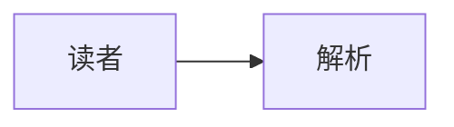

# Mermaid 示例

正文在代码块外。



~~~mermaid
sequenceDiagram
    Alice->>Bob: 你好
~~~

> 引用中的图：
>
> ```mermaid
> flowchart TD
>     Quoted --> Nested[嵌套]
> ```

```unknown_diagram
flowchart TD
    Untouched --> Plain
```

代码块后的正文。
